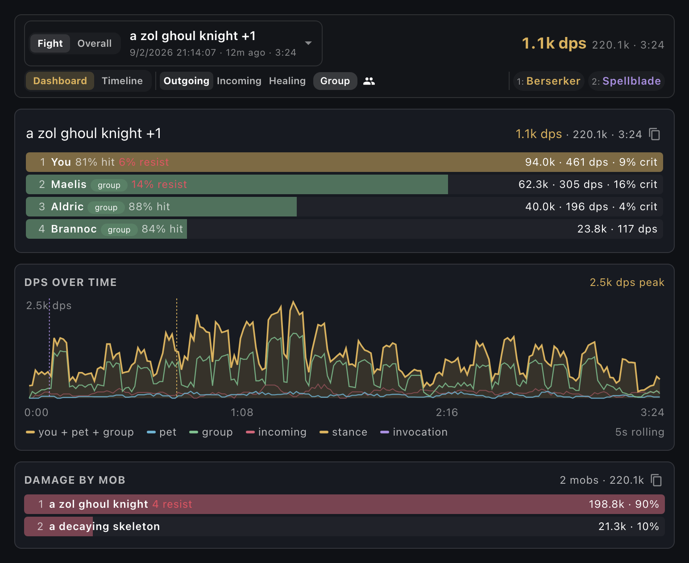
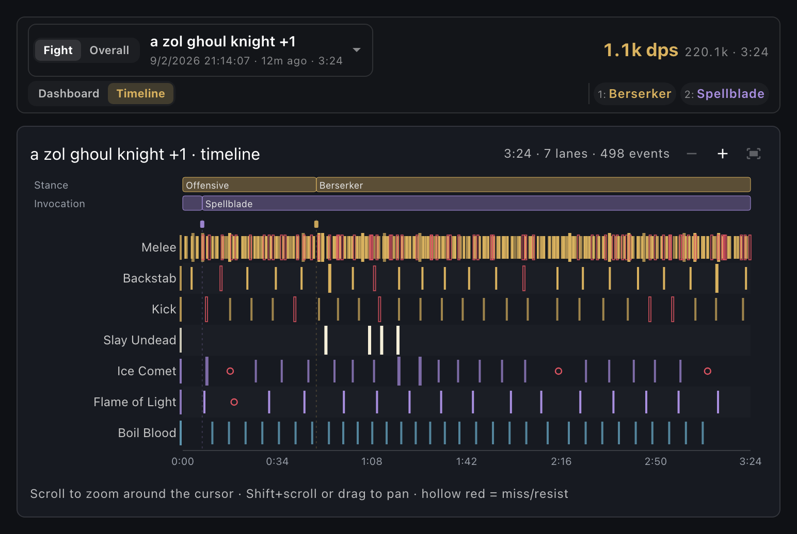

In August I released a companion app for a video game. I wanted to build a
sustainable software factory, and see how far I could push scope, scale, quality
and sustainability on a product with a lot of users and organic growth.

It grew quickly. Fourteen days after the first release it had 8.2K installs,
which have since grown to about 20K, and about 4K people using it on a given
day. For a niche classic game, that was a large share of the whole player base.
Players had sent 490 reports through the in-app feedback dialog and left about
200 comments on three Reddit posts. The three update videos had about 16.7K
views. I had shipped 39 releases.

This post is about the engineering setup behind that: how one person can run an
agentic development loop and keep it sustainable. I ran it for a month, until
the patch petered out and I paused playing myself. I built it to keep working in
my absence, with almost no infrastructure cost, and thousands of players still
use it. Below: how the product found its fit, how player reports became work for
the agents, and which decisions I kept for myself.

## A Little Background

My day job is CTO at Encamp, where I run product, engineering, compliance and
customer experience. I spend a lot of time there on how agents change the way
software gets built. I wanted to explore the frontier of that kind of
engineering on a project that was entirely mine, where I could push the pace and
the scope as far as they would go.

EverQuest Legends launched on July 28, 2026. It is a reimagining of the 1999
EverQuest, built by the indie studio Game Jawn with Daybreak, the series'
publisher, and tuned for solo play. It costs $19.99 with the first month
included, then $9.99 a month
([Worthplaying](https://worthplaying.com/article/2026/6/16/news/150224-everquest-legends-is-a-reimagined-version-of-the-classic-mmorpg-coming-in-july-trailer/),
[Massively
OP](https://massivelyop.com/2026/07/28/game-jawns-everquest-legends-officially-launches-this-afternoon-are-you-playing/)).
Many of its players are people like me, coming back after twenty-odd years.

MMO players have long run companion apps beside the game: separate programs that
analyze the game and enhance the experience. The goal is partly to min/max, and
partly to smooth out the rough in-game experiences that make a game hard to
enjoy. This is a real business. Overwolf is a platform for apps like these,
CurseForge is popular across Blizzard's games, and U.GG, OP.GG and dpm.lol are
popular across Riot's.

Mine became the default companion quickly, and I think for plain reasons:

- A signed installer with no setup
- Auto-discovery of the game on every machine
- Overlays drawn on top of the game
- Safe: it reads the log file, not memory or anything nefarious
- Open about the data it collected, and why
- A first release a week after the game
- Frequent updates that held up
- Novel features, plus what players asked for
- A clear vision from using it every day
- Listening to players in-app and across channels
- Stable overall, with problems fixed in hours
- Update videos I made myself, as a fellow gamer
- Direct contact on Reddit, YouTube and Twitch

## Stats and Timeline

| Metric                               |   Value |
| ------------------------------------ | ------: |
| Days of development                  |      31 |
| Commits                              |    1.9K |
| Merged worker branches               |     467 |
| GitHub releases                      |      50 |
| Linear tickets referenced in commits |     445 |
| Installs, first 14 days              |    8.2K |
| Best day of actives, first 14 days   |    4.1K |
| In-app feedback reports, 14 days     |     490 |
| Lifetime users (as of Nov 7)         |    ~20K |
| Peak daily actives (as of Nov 7)     |     ~6K |

<figure class="viz" data-src="cadence.svg"><figcaption>Commits and releases per day, August 4 to September 4. 1,334 of 1,888 commits (71%) landed by August 17.</figcaption></figure>

All of it was human-initiated, so the pace ebbed and flowed with me: my interest
in the game, my wish to expand scope, and my pushes on quality and platform
support. Some stretches were about letting existing features gel and releasing
them. Others were about expanding scope or changing something significant in the
architecture. I kept myself as the main bottleneck on purpose, and the
throughput was still very high.

## What It Is

The app tails the log file the game already writes. It doesn't read memory,
touch game files or automate anything. A server written in Rust parses each line
into an event and folds the stream of events into a model of the game world:
twenty state modules and a combat engine, which the app queries for live views.
From that one text file it builds:

- DPS (damage per second) and healing meters
- Per-fight drill-down and a fight timeline
- Overlays that sit on top of the game
- Buff and debuff timers
- XP per hour and respawn clocks
- Plane of Sky quest tracking
- Loot history and per-zone drop rates
- A gear planner with a wish list by zone
- Spoken alerts, with early warnings
- Maps and raid lockouts
- Resist data mined from your own log

The combat dashboard. Both images are recreated from the app's code with a simulated fight.

The fight timeline, one lane per ability. Hollow red marks are misses and resists.

It got bigger than I planned. Roughly:

| Part                          | Size                                |
| ----------------------------- | ----------------------------------- |
| TypeScript (Electron + React) | ~223K lines                         |
| Rust (the log engine)         | ~85K lines                          |
| Test files (TypeScript)       | 460, ~139K lines                    |
| Rust tests                    | 842                                 |
| End-to-end specs              | 62                                  |
| Log fixtures from real play   | 161                                 |
| Shipped game data             | 7.9K mobs, 11.2K items, 2.0K spells |

Around the app there is a code-signed installer, an auto-updater, an AWS backend
for feedback and usage counts that rarely goes beyond the free tier (Terraform,
its own account), and a CI pipeline that builds every release from a tag. In the
first two days I made the installer run under Wine, which brought in the Linux
and Mac players.

## Getting to 20,000 Users

The only promotion I did was three videos and three posts on r/EQLegends in the
first two weeks, plus the post where I paused.

| Date   | Public moment | Video views | Video comments | Reddit views | Reddit comments | Install surge |
| ------ | ------------- | ----------: | -------------: | -----------: | --------------: | ---------------: |
| Aug 4  | [Launch video + post](https://www.reddit.com/r/EQLegends/comments/1vfs5df/sharing_a_companion_app/) | [7,932](https://www.youtube.com/watch?v=LVFTHQjHxT4) | 162 | 16K | 64 | 251 |
| Aug 9  | [Update #2 + thank-you post](https://www.reddit.com/r/EQLegends/comments/1vk59oa/everquest_legends_companion_thank_you_to_community/) | [7,831](https://www.youtube.com/watch?v=UJljqXfksnE) | 87 | 68K | 95 | 2.6K |
| Aug 15 | [Update #3 + post](https://www.reddit.com/r/EQLegends/comments/1vophv6/eq_legends_companion_update_3/) | [3,420](https://www.youtube.com/watch?v=oV_oEN9Nhcw) | 42 | 28K | 57 | 2.5K |
| Sep 3  | [Pausing post](https://www.reddit.com/r/EQLegends/comments/1w6tk9r/eq_legends_companion_pausing_for_now_932026/) | | | 64K | 146 | |

The second post drew the most discussion, and it was mostly a thank-you with
five days of release notes attached. By then people in the thread had filed a
report and seen it fixed. Players told each other, on Reddit, Twitch, YouTube
and in-game. Some streamers installed it, chatters asked others whether they
knew about it, and a few gave feedback live on stream. Every so often I walked
through the Legends channels to see who was running it and who wasn't, and asked
anyone using it for feedback. That contact with the community helped.

I measured cohort retention from the start, cut along several lines: when people
installed, which version they came in on, and so on. People who installed in the
first four days came back at 93-97% the next day and 82-86% a week later. The
larger groups that arrived after the update posts settled at 52-60% and 41-48%.
Those numbers measure the game as much as the app, because the app only runs
when someone is playing, so I read the later figures as a floor. Daily actives
rose every day of the first two weeks.

## The Loop

<figure class="viz" data-src="loop.svg"><figcaption>The loop. A human sits in it twice: before the build and before the release.</figcaption></figure>

The human in the loop mattered more to how this went than anything else in it.
Every item came to me before it became work. At each triage I decided whether to
take it and whether the product's direction should change because of it. I don't
think an agent loop left on autopilot works, except in a very narrow context,
such as performance work against criteria a human chose, with a lower bound. The
agents made building cheap. They didn't decide what was worth building.

I sat in the loop a second time, after the agents' first pass. Before a feature
went to the public I used it in the game, in depth. Sometimes that took longer
than building the feature had. It matters a lot. You have to care about how it
feels.

The rest of this post walks through it.

## Player Feedback

Talking with the community gave me much of the energy and desire to keep
building. It was also a large part of why the project worked. Someone would
report a problem and it would be fixed within hours. The development lifecycle I
set up at the start made that sustainable. Observability was part of it, so I
could see which features people took up, and I systematically collected feedback
across every channel: YouTube, Reddit, the in-app dialog and more.

The voice of the customer came in through two automatic streams. The in-app
feedback dialog let a player send a bug or a request, with a scrubbed slice of
their log attached. Anonymous usage analytics showed which features were used
and where the app broke. Both were collected without me in the middle, and both
drove the triage loop.

Triage is a skill the agent runs when I ask. It covers five channels every time:
in-app reports, the error store, GitHub issues, the Reddit threads and YouTube
comments. I had to teach the agent that not all reports are created equal, and
that feedback is not a todo list. I never had it hide anything from me. I always
looked at the unfiltered data underneath, so that a wrong judgement in the
triage couldn't cost me fidelity.

<figure class="viz" data-src="triage.svg"><figcaption>Triage. Five channels go in, I decide, and every item leaves with an outcome.</figcaption></figure>

Items I haven't decided on stay parked and come back next session. A report is
done when the feedback system has a status on it and, if I accepted it, Linear
has a ticket.

I also watched the overall tenor across channels, to check I was focused on the
right themes. In a sample of 60 YouTube comments, about half were plain thanks.
Questions, problem reports and feature requests made up roughly 12 to 13% each.

The next few quotes are a little glaze. I include them to show that this kind of
process can get very good results if you care a lot and keep putting yourself in
your users' shoes. One player wrote through the in-app feedback on August 13:

> "It's literally the best made tool for EQ I've seen in my 25 years of playing
> the game."

Some of it was about play itself:

> "This tool is honestly a must have at this point. The parser is
> comprehensive, the audio triggers help me keep track of puma wearing off
> during longer fights, the sky tracker makes managing the turn ins less of a
> headache."

Some noticed small things. "I just found the cursor highlighter and, as an older
man with vision issues, this really helps me." One called the way buff timers
learn their durations from the log "CRAZY forethought." Another had been about
to ask for a buff overlay when it shipped: "read my mind!"

It reached places I hadn't planned for. Someone got it running on a Steam Deck.

People asked how to donate almost daily, and dozens of those requests came
through the in-app feedback. "I know you are just doing it for fun but you
should have a donations option." I didn't take money, partly because I didn't
want to be tied to supporting it if my interest in the game faded.

## Linear as Backlog, Agent Dispatch and Message Board

On August 5, the day after launch, I moved the project onto a Linear board.

The board is how I talk to the fleet when I'm not in the session:

- No deep backlog of every request
- I said no up front, often, to keep ticket noise out
- The board is not an archive of all feedback
- Everything accepted is force-ranked by me, by hand
- Each ticket is a brief an agent can build from
- It carries the story, decisions and criteria
- The planner re-reads the board before each pick
- Merge freely, test heavily before the release tag
- Titles say what the user gets
- Comments record pickup, merge and release

Reports from Reddit and YouTube can't be stamped the way in-app reports can, so
one pinned ticket holds a ledger of every outside item and what happened to it.

## The Build Cycle

The setup is the one I described in [Verifiable
Loops](/posts/verifiable-loops/), with more agents. One planner session
diagnoses, designs and writes briefs. It dispatches one to five workers in
parallel, each on its own branch and worktree, with file ownership that doesn't
overlap. Workers make their branch merge-ready: typecheck, lint, the full unit
suite, and the end-to-end specs they touched. The planner merges one branch at a
time and re-verifies on main before pushing. I capped it at five for two
reasons. I wanted the product's footprint to grow no faster than I could manage
its quality. And everything ran on my gaming PC, which could only build and test
so much in parallel. Scaling past that takes a managed agent setup with cloud
compute and custom images. My next post will cover that parallel managed agent
setup.

In the first two weeks that was 1,322 commits, 341 merged branches and 39
releases - about one merge an hour and three releases a day. Each merge is
roughly what a pull request would be on a team: one feature or one fix. Merges
could be that frequent because the gate was the release, not the merge. Work
landed on main continuously, and players only got what went out in a release.

## Keeping Quality Up

Quality came from two things, and I weight them equally. One is as much
automated testing as I could put in place, of every kind. The other is
experiencing the app myself, and looping until it was excellent.

### Experiencing the app

Developers post confessional videos to YouTube daily about the existential pain
of working with agents. They say they are losing interest, get no joy from the
process, and describe themselves as glorified QA bots. I have experienced the
opposite. I respect that way of thinking, and it is fair to say nobody knows
what the end game looks like. Frontier models move up the value chain every day.
But I think that view dramatically undersells the job. Caring enough about the
user's experience to build things that work well and matter to them has always
been why products succeed or fail. Linear took on a crowded space that Jira
dominated, made the experience far better, and won over much of it.

Most developers don't have good user-experience instincts, and haven't studied
design thinking. Being able to empathize with users matters more and more. The
combination of those skills with engineering is becoming far more valuable than
either alone, perhaps hundreds of times more. The industry is becoming bimodal,
in compensation and also in the fear and anxiety of people trying to stay inside
one narrow field. That is no criticism of someone with a deep technical focus in
databases, algorithm design or research at the edge of a field. The people being
displaced are those who lack deep specialization and also don't want to put
themselves in the user's shoes regularly.

This is the highly contextualized human in the diagrams above. I wrote about
that kind of person in [Foxes and Hedgehogs](/posts/foxes/): someone who knows
the product, the market and the design, and can also build. Agents give that
person much more reach.

### Automated testing

The other half is checks of many kinds. Each kind catches something the others
can't:

| Check                 | What it covers                                                                                                | When it runs          |
| --------------------- | ------------------------------------------------------------------------------------------------------------- | --------------------- |
| Type checks and lint  | Whole codebase. Lint exceptions are listed per file, and the list can only shrink                             | Every merge           |
| Unit tests            | 460 TypeScript test files, 842 Rust tests                                                                     | Every merge           |
| Real-log fixtures     | 161 spans of actual play with hand-checked expected results                                                   | Every merge           |
| End-to-end            | 62 specs that drive the real app window                                                                       | When app code changes |
| Oracle tests | When a technology was swapped, the old one was the oracle. The Rust engine had to match the TypeScript parser on the same logs before it took over | Before a swap |
| Performance budget    | The engine must process a synthetic log inside a fixed time                                                   | Every push            |
| Clean-machine install | A disposable Windows VM installs, launches with no game present, uninstalls, and checks the cleanup. 19 checks | Before a release      |
| Post-release smoke    | A VM downloads the published installer, verifies its checksum, and files one real bug report end to end      | After a release       |

The two halves feed each other. When I use the app and understand where a
problem in the experience comes from, I improve the design system and the
automated verification so that kind of problem can't come back. In effect I am
building my judgement into the verification harness. That can't be fully
automated, even now. The encoding step is the important one. I define the
criteria at a level where I believe the test really gates quality. Agents easily
build the wrong quality gate, one that guarantees nothing: tests that spin and
give tremendous false confidence.

<figure class="viz" data-src="harness.svg"><figcaption>Judgement moves into the verification harness. What is left still needs a human.</figcaption></figure>

## The Human

I was the first triage on every report, I kept control of the experience, and I
used the app every day I played. After the agents' first pass on a feature, I
used it in the game and sent it back until it felt right. I was specific about
the solution each time, drawing on my background in user experience and my own
values around design thinking. Sometimes that took longer than the build.

I reviewed the architecture regularly, and the high-gravity parts closely. The
idea comes from Will Larson's [Managing technical quality in a
codebase](https://lethain.com/managing-technical-quality/). He calls them
quality leverage points, and names interfaces, stateful systems and data models
as the three with the most impact. Design effort spent there pays off across
many later changes.

I have built my own version of this over my career. Mine covers the public APIs
and protocols, performance, testing and verification, and the UI and experience.

Beyond that, what I did:

- Set the direction
- Made every feature call
- Treated triage as one input
- Put stability and bug reports first
- Let taste and vision decide the rest
- Ranked platforms by player count
- Kept Mac and Linux moving in parallel
- Force-ranked the backlog in Linear
- Kept tickets in my own voice, ruthless about the why
- Played with the app running every day
- Said no, and deepened what existed
- Made the all-important architectural calls
- Stayed rigid on architecture where stability was at risk
- Corrected the process when it drifted
- Tested every feature by hand before each release

## The Pause

I stopped on September 3. I had paused playing, and I only want to build this
while I'm using it, so I [posted that development was pausing
too](https://www.reddit.com/r/EQLegends/comments/1w6tk9r/eq_legends_companion_pausing_for_now_932026/).
At that point the app had about 14K installs, about 7.5K people active in a
given week, and about 3K running it at once in the evening. It had been 49
releases and more than 1,850 fixes and features in a month.

I had chosen the license with this in mind. The source is available under
FSL-1.1-MIT, and each release becomes plain MIT two years after it ships. If I
don't come back to support it, the community can inherit it.

That post drew more attention than the launch did: 64K views and 146 comments,
against 16K views for the launch post. Most of the comments were thanks, and a
lot of them asked whether I'd be back for the next expansion. There's a
reasonable chance I will be.

## Closing

My takeaway is that, more than ever before, one person with high context, vision
and taste can build a complex, widely used piece of software, and do it
sustainably.

As a technical founder, I will be asking whether taking money and scaling early,
perhaps prematurely, is still the right model. The alternative is to grow
organically on my own, then fund expansion from sustainable profit. I have
become more skeptical of how outside funding shapes decisions. In all but a
small number of cases, I think it damages the outcome for the founders.

---

## TL;DR

- 8.2K installs in the first 14 days
- ~4K daily actives by day 14
- ~20K lifetime users since
- 31 days of development
- 1,888 commits, 467 merges, 50 releases
- 490 in-app reports, plus Reddit, YouTube, GitHub
- An agent triaged; human judgement decided relevance
- Linear as system of record: backlog and orchestration
- Verification designed around my own experience
- Ruthless automation
- I kept three jobs:
  - Deciding what got built, and saying no often
  - Reviewing the high-gravity architecture
  - Deciding whether it was good enough to ship

---

## References

[1] [EQ Legends Companion](https://github.com/jmoyers/everquest-companion) - source, releases and the agents' operating manual (`AGENTS.md`)

[2] [Launch video](https://www.youtube.com/watch?v=LVFTHQjHxT4) - EverQuest Legends Companion launch

[3] [Update #2 video](https://www.youtube.com/watch?v=UJljqXfksnE)

[4] [Update #3 video](https://www.youtube.com/watch?v=oV_oEN9Nhcw)

[5] [Sharing a companion app](https://www.reddit.com/r/EQLegends/comments/1vfs5df/sharing_a_companion_app/) - the launch post on r/EQLegends

[6] [Thank you to community](https://www.reddit.com/r/EQLegends/comments/1vk59oa/everquest_legends_companion_thank_you_to_community/) - the second post

[7] [Update #3](https://www.reddit.com/r/EQLegends/comments/1vophv6/eq_legends_companion_update_3/) - the third post

[8] [Pausing for now](https://www.reddit.com/r/EQLegends/comments/1w6tk9r/eq_legends_companion_pausing_for_now_932026/) - the post where I paused

[9] [Verifiable Loops](/posts/verifiable-loops/) - previous post on harnesses for agent work

[10] [Foxes and Hedgehogs](/posts/foxes/) - earlier post on high-context builders

[11] [Managing technical quality in a codebase](https://lethain.com/managing-technical-quality/) - Will Larson on quality leverage points

[12] [Worthplaying on EverQuest Legends](https://worthplaying.com/article/2026/6/16/news/150224-everquest-legends-is-a-reimagined-version-of-the-classic-mmorpg-coming-in-july-trailer/) - the game's announcement

[13] [Massively OP on the launch](https://massivelyop.com/2026/07/28/game-jawns-everquest-legends-officially-launches-this-afternoon-are-you-playing/) - launch day coverage
